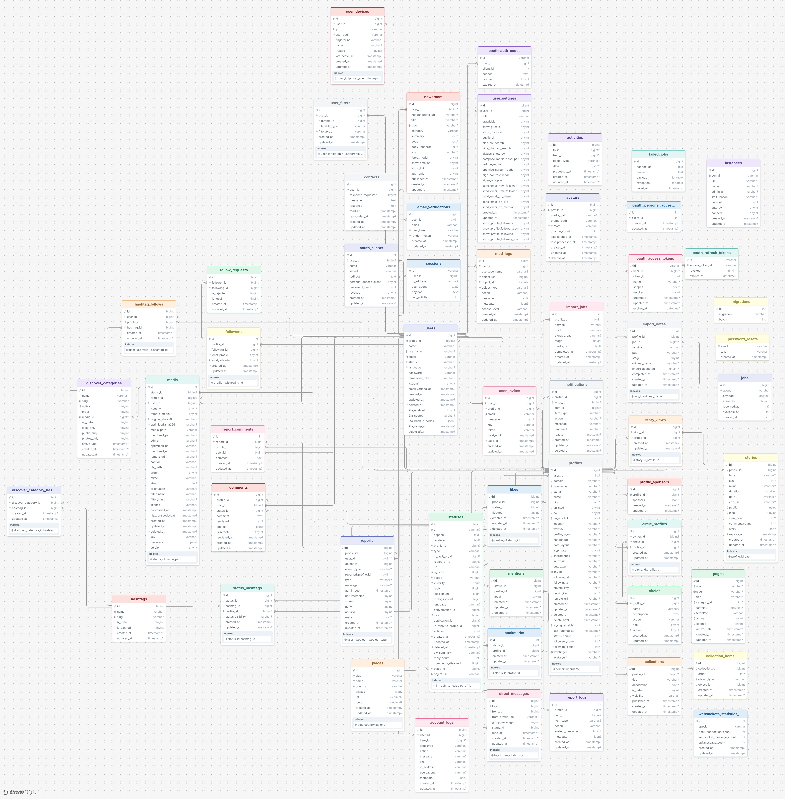
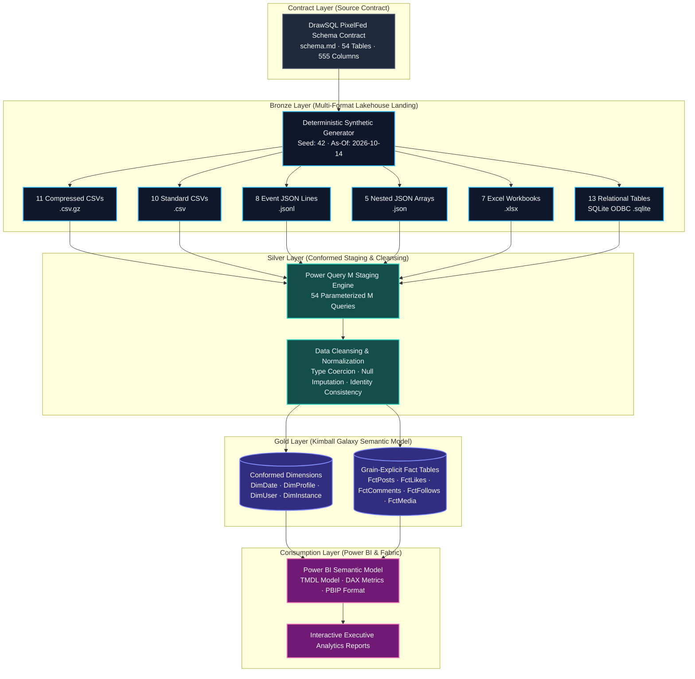
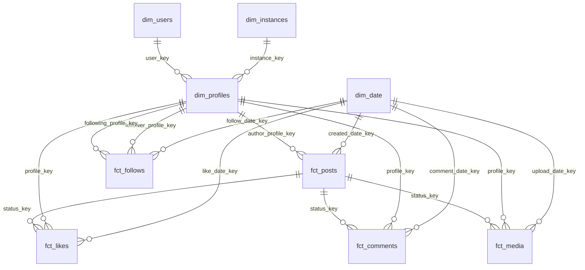

# PixelFed Analytics Engineering

<div align="center">

[](https://github.com/Sohila-Khaled-Abbas/pixelfed-analytics-engineering/actions)
[](https://www.python.org/)
[](https://powerbi.microsoft.com/)
[](docs/architecture/system-architecture.md)
[](schema.md)
[](https://drawsql.app/templates/pixelfed)
[](https://github.com/astral-sh/ruff)
[](tests/)
[](LICENSE)

<p align="center">
  <strong>PixelFed-Inspired Analytics Engineering Portfolio: Synthetic Lakehouse, Event Workloads, and Power BI Galaxy Model</strong>
</p>

[Architecture](#-architecture--medallion-lakehouse) •
[Original Resource](#-original-project-resource) •
[Lakehouse Matrix](#-mixed-format-lakehouse-matrix) •
[Dimensional Modeling](#-kimball-dimensional-galaxy-modeling) •
[Quickstart](#-developer-quickstart) •
[Quality & Tests](#-data-contracts--quality-gates) •
[Power BI Playbook](docs/power-bi-engineering-playbook.md) • [Business Data Contracts](docs/modeling/business-domain-data-contracts.md) • [Landing Refresh Runbook](docs/ingestion/landing-data-refresh-runbook.md) • [Raw-to-Silver Workflow](docs/ingestion/raw-landing-to-silver-workflow.md) • [Silver Null Policy](docs/ingestion/silver-null-handling-policy.md) • [Egypt Market Context](docs/modeling/egypt-market-context.md) • [Project Process](docs/project-process-guide.md) • [Domain Architecture](docs/architecture/domain-realism-architecture.md) • [Docs Hub](#-documentation-hub)

</div>

---

## 📌 Executive Overview

This repository demonstrates an end-to-end **Analytics Engineering workflow** for [PixelFed](https://pixelfed.org/)—the decentralized, federated photo-sharing social platform. 

Starting from an operational 54-table relational database contract, this project engineers a **reproducible, multi-format lakehouse landing zone (Bronze)**, translates and cleans the data through **Power Query M staging pipelines (Silver)**, and structures an enterprise-grade **Kimball Dimensional Galaxy Schema and Power BI Semantic Model (Gold)**.


> [!IMPORTANT]
> **The Strict One-Format Ingestion Rule:**  
> Every table in the 54-table schema is assigned to **exactly one native physical format**. The generator emits each table directly from in-memory synthetic rows. There are no redundant copies, no synthetic conversion chains (e.g. reading `.csv.gz` to write `.parquet`), and no duplicate exports.

---

## 🧪 Synthetic Data Realism & Scalable Event Workloads

The relational lakehouse is a **schema-faithful synthetic source replica**, not a claim to contain production PixelFed records. The domain-realism layer creates product-oriented patterns: local and federated profiles, creator activity skew, plausible photo/video/text mixes, topic-aware hashtags, meaningful captions, engagement after post publication, story views within story lifetimes, and counters reconciled against the generated event rows. The seed and as-of timestamp make runs reproducible.

The relational source replica intentionally remains local-machine friendly (the default 1.0x profile is approximately 97.6K rows across 54 tables). The business enrichment pass adds topic-oriented profile descriptions, discovery categories, privacy-aware settings and collections, event-linked notifications, moderation reports tied to posts, publication-aware comments/bookmarks, MIME-aligned media, and synthetic device cohorts using documentation-only IP ranges. Business-quality checks run before export and are recorded in metadata/data_quality_report.json. The optional `--raw-quality` profile adds a small, reproducible set of nullable-text, whitespace, and timestamp-format issues **after** core business validation, while preserving row counts and primary/foreign keys. This makes landing data realistic for Bronze-to-Silver cleaning exercises rather than pretending raw data is already clean. **That size alone is not big data.** For a separate scale-oriented workload, use the streaming event generator: it writes gzip-compressed JSONL in monthly partitions, with event grain, event/ingestion timestamps, source application, actor and object references, late-arrival metadata, and a manifest. It defaults to one million events and 50,000 synthetic profiles without accumulating the complete event table in memory. It also emits a joinable `dimensions/dim_profile.csv.gz` with account creation time, local/federated host, country/language, privacy, interests, and creator tier. Actors and targets only appear after their synthetic account creation time, and the high-activity creator cohort matches the dimension's `power_creator` tier.

```powershell
# Smoke test: small monthly partitions, quick to inspect
python src/generate_activity_stream.py --events 10000 --profiles 2000 --seed 42 --output-dir ./tmp_activity_stream

# Scale workload: one million events, 50K synthetic profiles
python src/generate_activity_stream.py --events 1000000 --profiles 50000 --seed 42 --output-dir ./data/activity_stream

# Inspect the generated counts, partitions, event-type mix and quality report
Get-Content ./data/activity_stream/manifest.json
Get-Content ./data/activity_stream/quality_report.json

# Optional: create DuckDB Bronze/Silver/Gold views and preview daily Gold metrics
pip install duckdb
python -c "import duckdb, pathlib; con=duckdb.connect('data/activity_analytics.duckdb'); con.execute(pathlib.Path('sql/activity_stream_gold.sql').read_text(encoding='utf-8')); print(con.sql('SELECT * FROM gold_daily_product_metrics ORDER BY event_date LIMIT 10').df())"
```

The stream is suitable for practicing incremental/partition-aware ingestion, event-time versus ingestion-time analysis, schema evolution, deduplication keys, late-arriving data, and gold-level engagement metrics. It is **synthetic benchmark data**, not a deployment benchmark or proof of production throughput. See [Synthetic Workloads & Data Contracts](docs/modeling/synthetic-workloads.md) and the [DuckDB Bronze/Silver/Gold models](sql/activity_stream_gold.sql) for grains, assumptions, quality checks, and runnable SQL examples.

---

## 🧹 Safe Landing Refresh & Raw-Data Practice

Use the safe refresh wrapper to build a candidate and validate the mixed-format exports. The active `data/landing` directory is only replaced when you explicitly pass `--promote`. The previous landing folder is retained as a dated backup.

See the [Raw Landing to Silver Workflow](docs/ingestion/raw-landing-to-silver-workflow.md) and [End-to-End Project Process](docs/project-process-guide.md).

```powershell
# Candidate only: active data/landing is not changed
python src/refresh_landing.py --scale 0.03 --seed 42 --as-of 2026-10-27T12:00:00Z

# Full-size refresh: validates first, then backs up and promotes
python src/refresh_landing.py --scale 1.0 --seed 42 --as-of 2026-10-27T12:00:00Z --promote
```

The generated tables remain synthetic and Git-ignored. Publish code, tests, data contracts, and guides—not local landing data or backup directories.

---

## 🔗 Original Project Resource

The foundational relational schema contract and entity-relationship architecture for this project originates from the canonical PixelFed database design on DrawSQL:

- **Interactive ER Diagram & Source Contract:** [DrawSQL PixelFed Template](https://drawsql.app/templates/pixelfed)
- **Local Contract Definition:** [`schema.md`](schema.md) (54 tables, 555 columns, data types, keys, and indexes)
- **Source MySQL DDL:** [`database/mysql_source_ddl.sql`](database/mysql_source_ddl.sql)

<details>
<summary><strong>🔍 Click to expand the full 54-Table Relational Schema Diagram</strong></summary>

<br />

<div align="center">
  
  <p><em>Canonical 54-Table Relational Schema sourced from DrawSQL</em></p>
</div>

</details>

---

## 🏗️ Architecture & Medallion Lakehouse

The data platform follows the **Medallion Lakehouse Pattern**, transitioning data through three distinct zones of refinement:



---

## 📦 Mixed-Format Lakehouse Matrix

To simulate real-world modern data engineering ingestion challenges, the 54 operational tables are distributed across 6 distinct physical storage technologies:

| Format Group | Tables | Share (%) | Total Rows (1.0x) | Engineering Rationale & Processing Pattern |
|:---|:---:|:---:|:---:|:---|
| <kbd>`.csv.gz`</kbd> | **11** | 20.4% | ~54,800 | **Largest relational event/fact tables** (posts, likes, comments, media). Ingested via binary stream decompression in Power Query. |
| <kbd>`.csv`</kbd> | **10** | 18.5% | ~6,500 | **Core relational master entities** (users, profiles, hashtags, collections). Standard tabular import with strict schema typing. |
| <kbd>`.jsonl`</kbd> | **8** | 14.8% | ~12,600 | **Semi-structured event telemetry & audit trails** (mod logs, activities, notifications). Line-by-line JSON record parsing. |
| <kbd>`.json`</kbd> | **5** | 9.3% | ~1,700 | **Nested document arrays** (direct messages, import jobs, profile sponsors). Flattens relational arrays and extracts JSON keys. |
| <kbd>`.xlsx`</kbd> | **7** | 13.0% | ~1,300 | **Business extracts & slow configurations** (discover categories, places, user devices). Ingested via OpenXML workbook readers. |
| <kbd>`.sqlite`</kbd> | **13** | 24.1% | ~20,700 | **Operational auth & security data** (sessions, OAuth tokens, password resets). Consolidated into a single relational DB via ODBC. |
| **Total** | **54** | **100%** | **97,672** | **Full contract coverage. Every table has exactly one physical home.** |

<details>
<summary><strong>📋 Click to view complete Table-by-Table Format Allocation</strong></summary>

<br />

| Table Name | Assigned Format | Primary Key | Key Relationships | Domain Category |
|:---|:---:|:---:|:---|:---|
| `statuses` | `csv_gz` | `id` | `profile_id → profiles.id` | Content Core |
| `likes` | `csv_gz` | `id` | `profile_id`, `status_id` | Social Engagement |
| `comments` | `csv_gz` | `id` | `profile_id`, `status_id` | Social Engagement |
| `media` | `csv_gz` | `id` | `profile_id`, `status_id` | Rich Media Assets |
| `followers` | `csv_gz` | `id` | `profile_id`, `following_id` | Social Graph |
| `status_hashtags` | `csv_gz` | `id` | `status_id`, `hashtag_id` | Taxonomy / Tagging |
| `mentions` | `csv_gz` | `id` | `status_id`, `profile_id` | Interactions |
| `story_views` | `csv_gz` | `id` | `story_id`, `user_id` | Ephemeral Media |
| `hashtag_follows` | `csv_gz` | `id` | `user_id`, `hashtag_id` | User Interests |
| `reports` | `csv_gz` | `id` | `user_id`, `object_id` | Trust & Safety |
| `report_comments` | `csv_gz` | `id` | `report_id`, `user_id` | Moderation |
| `users` | `csv` | `id` | `id → profiles.user_id` | Identity & Auth |
| `profiles` | `csv` | `id` | `user_id`, `instance_id` | Federation Persona |
| `hashtags` | `csv` | `id` | Tag dictionary | Taxonomy |
| `bookmarks` | `csv` | `id` | `profile_id`, `status_id` | User Collections |
| `collections` | `csv` | `id` | `profile_id` | User Collections |
| `collection_items` | `csv` | `id` | `collection_id`, `object_id` | User Collections |
| `circles` | `csv` | `id` | `profile_id` | Close Friends Graph |
| `circle_profiles` | `csv` | `id` | `circle_id`, `profile_id` | Close Friends Graph |
| `avatars` | `csv` | `id` | `profile_id` | Media Metadata |
| `stories` | `csv` | `id` | `profile_id` | Ephemeral Media |
| `account_logs` | `jsonl` | `id` | `user_id` | Security Audit |
| `activities` | `jsonl` | `id` | `to_id`, `from_id` | ActivityPub Stream |
| `failed_jobs` | `jsonl` | `id` | Job queue error log | Queue Telemetry |
| `jobs` | `jsonl` | `id` | Background worker queue | Queue Telemetry |
| `mod_logs` | `jsonl` | `id` | `user_id`, `object_id` | Moderation Audit |
| `notifications` | `jsonl` | `id` | `profile_id`, `item_id` | Activity Feed |
| `report_logs` | `jsonl` | `id` | `report_id`, `user_id` | Moderation Audit |
| `websockets_statistics_entries` | `jsonl` | `id` | Real-time socket metrics | System Telemetry |
| `direct_messages` | `json` | `id` | `to_id`, `from_id` | Private Messaging |
| `discover_category_hashtags` | `json` | `id` | `category_id`, `hashtag_id` | Discovery Engine |
| `import_datas` | `json` | `id` | `user_id` | Data Portability |
| `import_jobs` | `json` | `id` | `user_id` | Data Portability |
| `profile_sponsors` | `json` | `id` | `profile_id` | Monetization |
| `discover_categories` | `xlsx` | `id` | Category taxonomy | Discovery Catalog |
| `instances` | `xlsx` | `id` | Remote Fediverse hosts | Federation Topology |
| `migrations` | `xlsx` | `id` | DB schema migrations | Infrastructure |
| `places` | `xlsx` | `id` | Geocoding & locations | Geospatial |
| `oauth_personal_access_clients` | `xlsx` | `id` | `client_id` | API Infrastructure |
| `user_devices` | `xlsx` | `id` | `user_id` | Mobile & Web Devices |
| `user_settings` | `xlsx` | `id` | `user_id` | Preferences |
| `contacts` | `sqlite` | `id` | `user_id` | Address Book |
| `email_verifications` | `sqlite` | `id` | `user_id` | Account Verification |
| `follow_requests` | `sqlite` | `id` | `follower_id`, `following_id` | Private Graph |
| `newsroom` | `sqlite` | `id` | `user_id` | Announcements |
| `oauth_access_tokens` | `sqlite` | `id` | `user_id`, `client_id` | OAuth 2.0 Security |
| `oauth_auth_codes` | `sqlite` | `id` | `user_id`, `client_id` | OAuth 2.0 Security |
| `oauth_clients` | `sqlite` | `id` | `user_id` | OAuth 2.0 Applications |
| `oauth_refresh_tokens` | `sqlite` | `id` | `access_token_id` | OAuth 2.0 Security |
| `pages` | `sqlite` | `id` | Static instance pages | CMS Content |
| `password_resets` | `sqlite` | `id` | Password reset tokens | Account Security |
| `sessions` | `sqlite` | `id` | `user_id` | Web Sessions |
| `user_filters` | `sqlite` | `id` | `user_id` | Content Filtering |
| `user_invites` | `sqlite` | `id` | `user_id` | Registration Invites |

</details>

---

## 🌌 Kimball Dimensional Galaxy Modeling

In an analytics engineering mindset, attempting to join all social interactions (likes, comments, media, followers) into a single flat table results in severe **cartesian fan-out** and duplicate metric aggregation. 

Instead, this project employs a **Kimball Galaxy Schema (Constellation Schema)**: multiple independent fact tables sharing conformed enterprise dimensions.

### Kimball Bus Matrix

| Business Process (Fact Table) | Granularity | Dim Date | Dim Profile | Dim User | Dim Instance | Dim Hashtag |
|:---|:---|:---:|:---:|:---:|:---:|:---:|
| **Post Publications** (`fct_posts`) | 1 row per post / status | `X` | `X` | | `X` | `X` |
| **User Likes** (`fct_likes`) | 1 row per like event | `X` | `X` | | | |
| **Comments** (`fct_comments`) | 1 row per comment | `X` | `X` | | | |
| **Social Follows** (`fct_follows`) | 1 row per follow edge | `X` | `X` | | | |
| **Media Assets** (`fct_media`) | 1 row per uploaded asset | `X` | `X` | | | |
| **Story Impressions** (`fct_story_views`) | 1 row per story view | `X` | `X` | `X` | | |

### Galaxy Schema Topology



> [!TIP]
> **Single-Direction Filter Propagation:**  
> All semantic model relationships are configured with **single-direction cross-filtering (`1:*`)** from Dimensions to Facts. This eliminates bidirectional ambiguity and guarantees performant, accurate DAX calculations.

---

## ⚡ Developer Quickstart

### 1. Prerequisites
- **Python**: `>= 3.10`
- **Power BI Desktop**: May 2024 or later (supports `.pbip` project files)
- **ODBC Driver**: SQLite3 ODBC Driver (optional, for direct SQLite queries)

### 2. Environment Setup

```powershell
# Clone repository
git clone https://github.com/Sohila-Khaled-Abbas/pixelfed-analytics-engineering.git
cd pixelfed-analytics-engineering

# Create and activate virtual environment
python -m venv .venv
.\.venv\Scripts\Activate.ps1

# Install runtime and development dependencies
pip install --upgrade pip
pip install -r requirements.txt
pip install -r requirements-dev.txt
```

*(On Linux / macOS, use `source .venv/bin/activate`)*

### 3. Generate Synthetic Lakehouse Data

Run a smoke-test dry-run at 2% scale:

```powershell
python src/generate_landing.py --scale 0.02 --seed 42 --output-dir ./data/landing_test
```

Generate the full-fidelity dataset (1.0x scale, ~97.6K records):

```powershell
python src/generate_landing.py --scale 1.0 --seed 42 --as-of 2026-10-14T12:00:00Z
```

The relational output is intentionally small enough for local Power BI development. For a larger, streaming workload with monthly event partitions, run the [activity-stream generator](#-synthetic-data-realism--scalable-event-workloads).

### 4. Validate Lakehouse Landing Zone

Execute the validation engine to assert schema contracts, format compliance, row counts, and SQLite integrity:

```powershell
python src/validate_landing.py
```

Expected output:
```text
VALIDATION PASSED
Tables: 54
Rows: 97,672
Formats: {'csv_gz': 11, 'csv': 10, 'jsonl': 8, 'json': 5, 'xlsx': 7, 'sqlite': 13}
Every source table exists exactly once in its assigned native format.
SQLite integrity: OK; foreign-key violations: 0
```

### 5. Open the Power BI Semantic Model

Launch the project in Power BI Desktop via the version-controlled `.pbip` project:

```powershell
Start-Process "powerbi\PixelFed_report.pbip"
```

---

## 📊 Power BI Engineering Guide\n\nFor a complete GUI-first workflow using the existing `data/landing` datasets—including Power Query UI steps, reusable M patterns, dynamic `DimDate` and `DimTime`, the `DimProfile`-centered galaxy, DAX measures, relationships, accessibility, performance, and release checks—start with the **[Power BI Engineering Playbook](docs/power-bi-engineering-playbook.md)**. It complements the detailed [Power Query pipeline guide](docs/ingestion/power-query-pipeline.md), [manual UI walkthrough](docs/ingestion/power-query-ui-walkthrough.md), and [dimensional galaxy guide](docs/modeling/dimensional-galaxy-guide.md).\n\n---\n\n## 🧪 Data Contracts & Quality Gates

Software engineering guidelines dictate that data assets must be backed by automated assertions and continuous integration.

### Test Suite (`tests/`)

We execute automated tests via `pytest` covering:

- `test_schema_contracts.py`: Validates exact 54-table count, 555-column definitions, and primary keys.
- `test_format_assignment.py`: Verifies zero format overlapping and exact format bucket distribution.
- `test_generator_reproducibility.py`: Asserts deterministic data output across seeds and validates referential integrity.
- `test_landing_validation.py`: Tests manifest contracts, column ordering, and SQLite PRAGMA integrity.

Run the test suite locally:

```powershell
pytest -v
```

### GitHub Actions CI/CD Pipeline

Every push and Pull Request triggers our automated GitHub Actions workflow (`.github/workflows/ci.yml`):
1. Matrix testing across Python `3.10`, `3.11`, `3.12` on both `ubuntu-latest` and `windows-latest`.
2. Static analysis and code formatting verification with `ruff`.
3. Execution of the full `pytest` test suite.
4. An end-to-end synthetic data generation and validation dry-run.

---

## 📂 Repository Directory Layout

```text
pixelfed-analytics-engineering/
├── .github/
│   ├── ISSUE_TEMPLATE/             # Structured GitHub Issue forms
│   │   ├── config.yml
│   │   ├── data_bug.yml
│   │   └── feature_request.yml
│   ├── workflows/                  # CI/CD pipelines
│   │   ├── ci.yml                  # Automated build, lint, test, dry-run
│   │   └── documentation.yml       # Markdown link & integrity validator
│   ├── dependabot.yml              # Automated dependency management
│   └── PULL_REQUEST_TEMPLATE.md    # Analytics Engineering PR template
├── assets/                         # Architecture diagrams & DrawSQL ERD
│   ├── architecture.svg            # Medallion lakehouse vector diagram
│   └── db-diagram.webp             # Canonical 54-table DrawSQL diagram
├── config/                         # Data contract configurations
│   └── table_format_assignment.json # Physical table-to-format mapping
├── database/                       # SQL DDL & warehouse definitions
│   ├── dimensional_models_ddl.sql  # Gold Layer Kimball Galaxy schema DDL
│   └── mysql_source_ddl.sql        # Canonical MySQL source schema DDL
├── docs/                           # Master Engineering Documentation Hub
│   ├── architecture/               # Architecture, identity, roadmap
│   │   ├── identity-consistency.md
│   │   ├── project-roadmap.md
│   │   └── system-architecture.md
│   ├── contracts/                  # Data dictionary & format catalog
│   │   ├── data-dictionary.md
│   │   └── format-catalog.md
│   ├── ingestion/                  # Multi-format & Power Query guides
│   │   ├── mixed-format-lakehouse.md
│   │   ├── power-query-pipeline.md
│   │   ├── power-query-ui-walkthrough.md
│   │   └── sqlite-odbc-staging.md
│   ├── modeling/                   # Dimensional modeling & cleansing
│   │   ├── data-cleaning-playbook.md
│   │   ├── dimensional-galaxy-guide.md
│   │   └── semantic-model-design.md
│   ├── semantic-layer/             # Fabric / Power BI TMDL guides
│   │   └── tmdl-semantic-models.md
│   └── README.md                   # Documentation index & navigation
├── powerbi/                        # Power BI Desktop PBIP semantic project
│   ├── PixelFed_report.Report/     # Visual report layouts
│   ├── PixelFed_report.SemanticModel/ # Data model, partitions, relationships
│   └── PixelFed_report.pbip        # PBIP project file
├── src/                            # Analytics Engineering pipeline code
│   ├── tmdl/                       # TMDL staging script generation
│   │   ├── 01_Create_Core_Staging_Tables.tmdl
│   │   └── Create_Staging_Tables.tmdl
│   ├── __init__.py
│   ├── generate_landing.py         # Mixed-format synthetic generator CLI
│   ├── schema_generator_core.py    # Schema parser & synthetic generation engine
│   └── validate_landing.py         # Lakehouse validation suite CLI
├── tests/                          # Automated pytest suite (including domain and event-stream tests)
│   ├── __init__.py
│   ├── conftest.py                 # Pytest session fixtures
│   ├── test_format_assignment.py
│   ├── test_generator_reproducibility.py
│   ├── test_landing_validation.py
│   └── test_schema_contracts.py
├── .editorconfig                   # Cross-platform editor whitespace standards
├── .gitignore                      # Git ignore rules (excludes raw generated data)
├── .pre-commit-config.yaml         # Git pre-commit hooks (ruff, trailing-whitespace)
├── CHANGELOG.md                    # Keep a Changelog semantic release log
├── CODE_OF_CONDUCT.md              # Contributor Covenant v2.1
├── CONTRIBUTING.md                 # Contribution guidelines
├── LICENSE                         # MIT License
├── pyproject.toml                  # Modern PEP 517/621 packaging & tool config
├── requirements.txt                # Core runtime dependencies
├── requirements-dev.txt            # Development & testing dependencies
└── schema.md                       # Canonical 54-table source contract
```

---

## 📖 Documentation Hub

Explore the full documentation suite in [`docs/`](docs/README.md):

| Guide | Description |
|:---|:---|
| **[System Architecture](docs/architecture/system-architecture.md)** | End-to-end Medallion lakehouse principles and flow. |
| **[Data Dictionary](docs/contracts/data-dictionary.md)** | Column-by-column reference for all 54 tables and 555 columns. |
| **[Format Catalog](docs/contracts/format-catalog.md)** | Technical specifications for each physical format assignment. |
| **[Dimensional Galaxy Guide](docs/modeling/dimensional-galaxy-guide.md)** | In-depth dimensional galaxy modeling and bus matrix design. |
| **[Data Cleaning Playbook](docs/modeling/data-cleaning-playbook.md)** | Null handling, type coercion, and edge-case resolution rules. |
| **[Power Query Pipeline](docs/ingestion/power-query-pipeline.md)** | Production-ready Power Query M scripts for all 54 tables. |
| **[Semantic Model Design](docs/modeling/semantic-model-design.md)** | Single-direction relationships, DAX measures, and filter propagation. |
| **[TMDL Automation](docs/semantic-layer/tmdl-semantic-models.md)** | Microsoft Fabric / Power BI Tabular Model Definition Language scripts. |

---

## 🔒 Data Governance & Synthetic Mock Data

> [!CAUTION]
> **Synthetic Privacy Assurance:**  
> All records produced by the generator are 100% synthetic, generated for academic and portfolio demonstration purposes.  
> 
> Any tokens, hashed passwords, IP addresses, email addresses, or user agents are randomly synthesized and non-functional. Real PixelFed production user data is never stored or committed to this repository.

---

## 📄 License & Attribution

- **Project License:** This project is open-source under the [MIT License](LICENSE).
- **Original Source Contract Attribution:** PixelFed schema template provided by [DrawSQL](https://drawsql.app/templates/pixelfed).
- **PixelFed Application:** PixelFed is developed by [Daniel Supernault](https://github.com/dansup) under the GNU AGPL v3.0 license. This project is an independent analytics engineering study.
