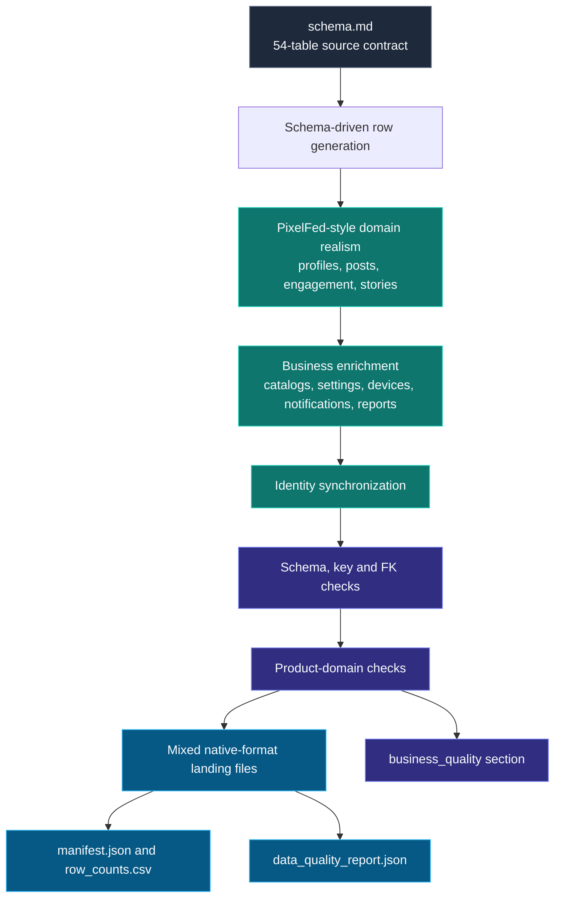

# Business-Domain Enrichment Architecture

This layer improves the synthetic training data without claiming to reproduce PixelFed production data. A fixed seed makes generated records repeatable. The enrichment must preserve the 54-table schema contract, row counts, column order, and one-format-per-table assignment.

## Generation and quality flow

## Business rules added

| Area | Rule | Reporting practice enabled |
|---|---|---|
| Creator profiles | Topic-aware bios, creator activity cohort, local/federated context | Creator segments and cohort comparisons |
| Discovery catalog | Human-readable category names, unique slugs, explicit flags | Category mix and discovery analytics |
| Media | MIME family aligns with the target post type; metadata records content family | Image/video mix, media-size and pipeline exercises |
| Comments | Reference a real post, follow post creation, avoid self-comments when possible | Engagement lag and conversation reporting |
| Bookmarks | Created at or after the target post | Saved-content behavior |
| Notifications | Actor, recipient, action, item type and item ID derive from a like/comment/follow when available | Notification volume and interaction channel |
| Moderation | Report targets an existing status, identifies its author, and follows publication | Report rate and review timing |
| Settings and devices | Preferences are varied; IPs use documentation-only ranges and user agents are explicitly synthetic | Privacy/accessibility cohorts without real network identifiers |
| Collections | Theme, visibility and publication timestamp are meaningful | Curation and publication behavior |

## Code ownership

- **src/domain_realism.py** handles the first behavioral layer: account/profile identity, content, hashtag linkage, engagement, follows, and story views.
- **src/business_enrichment.py** adds business-oriented details and checks cross-table semantics.
- **src/schema_generator_core.py** invokes both layers, synchronizes identities, and writes the combined generation-quality report.
- **src/generate_landing.py** writes each table directly into its assigned physical format.
- **src/validate_landing.py** verifies exported files, counts, headers, and the SQLite subset.

The quality report is written to metadata/data_quality_report.json. It should contain passed=true, domain_quality.passed=true, and business_quality.passed=true.

## Interpretation cautions

1. The creator cohort and activity distributions are synthetic assumptions, not measured estimates of real PixelFed behavior.
2. example.test hosts and documentation-only IP ranges must not be interpreted as real identities or network telemetry.
3. Privacy, visibility, locality, and federation are separate dimensions.
4. Aggregate facts at their declared grain before joining facts with different grains, otherwise likes/comments/media can multiply counts.
5. Synthetic report labels are generated learning examples and are not claims about real users or actual moderation decisions.

See the [business-domain data contracts](../modeling/business-domain-data-contracts.md) and [safe landing refresh runbook](../ingestion/landing-data-refresh-runbook.md).
