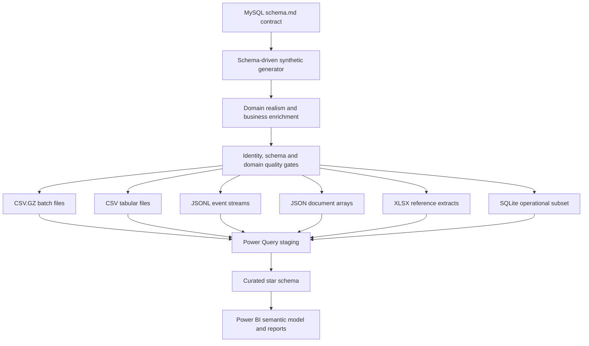

# Architecture

## Principles

1. **Schema-first:** `schema.md` is the contract for the 54 table and column definitions.
2. **One table, one format:** a table is assigned to exactly one physical representation.
3. **No format conversion chain:** generation creates files from in-memory rows; it never reads one exported format to make another.
4. **Reproducibility:** seed, reference time, table assignments and row counts are recorded in the manifest.
5. **Quality gates:** key, nullability, unique-index and referential checks run before export.
6. **Layer separation:** staging mirrors source shape; curated facts/dimensions implement reporting semantics.

## Business-domain quality layer

The generator now runs the original domain checks and a business-enrichment validation pass before export. See the [Business-Domain Enrichment Architecture](domain-realism-architecture.md), [Business-Domain Data Contracts](../modeling/business-domain-data-contracts.md), and [Safe Landing Refresh Runbook](../ingestion/landing-data-refresh-runbook.md).
