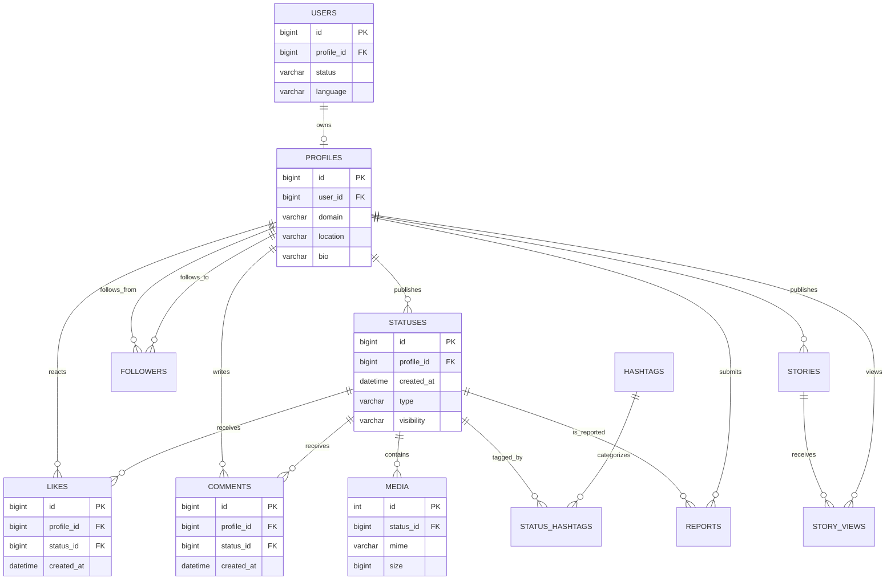

# Business-Domain Data Contracts and Analytics Use Cases

## Scope

This guide defines business meaning behind the synthetic PixelFed-like landing zone. It is a training data contract, not an authoritative description of every production implementation. All accounts, events, device metadata, text, and moderation cases are synthetic.

The schema contract remains authoritative for column names, nullability, and physical keys. Business enrichment populates existing fields and must preserve row counts and format assignments.

## Conceptual model

## Table grains and quality expectations

| Table | Grain | Business meaning | Quality rule |
|---|---|---|---|
| **users** | One local account | Account status, locale, lifecycle | Connect to profiles through ownership keys; never equate independent table IDs |
| **profiles** | One local or federated profile | Creator/audience identity, privacy, home instance | Remote profiles may lack a local user; domain matches synthetic instance catalog |
| **statuses** | One published post | Content, timestamp, visibility, author and reply/boost relationships | Timestamp is within run cutoff; reply/boost points to existing post |
| **likes** | One like event | Positive interaction | Target exists; event does not predate publication |
| **comments** | One comment event | Conversation and responses | Target exists; event follows publication; self-comment is avoided where population permits |
| **media** | One attachment | Image/video format and processing details | Photo posts use image MIME; video posts use video MIME |
| **followers** | One directed follow edge | Audience graph | No self-follow or duplicate directed edge |
| **status_hashtags** | One status/hashtag bridge row | Topic discovery | Bridge references exist; embedded status tags reconcile to bridge rows |
| **stories** | One ephemeral story | Short-lived content | View timestamp is within story lifetime |
| **story_views** | One profile viewing one story | Ephemeral engagement | Story and viewer exist; view is within creation/expiry window |
| **notifications** | One notification | Interaction signal to a recipient | Actor, recipient, action, item type and item ID come from a real generated event when available |
| **reports** | One moderation report | Reported content for review | Status exists; target profile is status author; report follows publication |
| **collections** | One profile-owned collection | Content curation | Visibility and publication time remain interpretable |
| **bookmarks** | One profile saving one status | Intent to revisit content | Bookmark does not predate target post |
| **user_settings** | One local user's settings | Privacy, accessibility, discovery, notifications | Boolean-like flags are 0/1; discovery/crawlability reflects synthetic privacy context |
| **user_devices** | One synthetic registered device | Device cohort and last-active recency | User exists; agents are synthetic; IP uses documentation-only range |

## Analytics bus matrix

| Business process | Date | Profile | Status | Hashtag | Instance | Example measures |
|---|---:|---:|---:|---:|---:|---|
| Publishing | ✓ | ✓ | ✓ | ✓ | ✓ | Posts published, media mix, public share |
| Likes and comments | ✓ | ✓ | ✓ | ✓ | ✓ | Likes, comments, engagement lag, comments per post |
| Follows | ✓ | ✓ (actor/target roles) | — | — | ✓ | Follows created, local-to-remote share |
| Stories | ✓ | ✓ | ✓/story | — | ✓ | Story views, views per story, time-to-expiry |
| Moderation | ✓ | ✓ (reporter/subject roles) | ✓ | — | ✓ | Reports, reports per 1,000 posts, review delay |
| Discovery | ✓ | ✓ | ✓ | ✓ | ✓ | Content by topic, category mix, federation share |
| Media | ✓ | ✓ | ✓ | — | ✓ | Attachment volume, MIME mix, media bytes |
| Device/settings | ✓ | ✓ | — | — | — | Device cohorts and accessibility preferences |

Use role-playing dimensions for follow edges and moderation. Choose explicit role-playing tables or carefully documented active/inactive relationships. Avoid bidirectional relationships as a shortcut.

## Suggested fact grains

- **FactPosts:** one row per status/post, keyed by status ID.
- **FactLikes:** one row per like, with event date/time, actor, target status, and active/deleted state.
- **FactComments:** one row per comment, with commenter and target status.
- **FactFollows:** one row per directed follow edge, with actor and target roles.
- **FactMedia:** one row per media attachment, with MIME family and size.
- **FactStoryViews:** one row per story-view event.
- **FactReports:** one row per moderation report, with reporter, target, type, and review timestamps.

Conformed dimensions typically include DimDate, DimTime, DimProfile, DimUser, DimInstance, DimStatusType, DimVisibility, DimHashtag, and (where needed) DimDeviceType. Keep DimProfile and DimUser separate because federated profiles need not have local accounts.

## KPI definitions to document in the semantic model

- **Posts published:** count statuses by status ID and explicitly document deleted-row handling.
- **Active likes:** count likes where deleted_at is blank. A raw like-event count is a different metric.
- **Comment events:** count at comment grain, not after joining unaggregated likes.
- **Engagement events:** sum compatible aggregated measures; do not sum duplicated fact rows after many-to-many joins.
- **Public post share:** public posts divided by all posts in filter context; state whether unlisted content enters the denominator.
- **Federated share:** define the unit explicitly—profile, post, or event—before selecting numerator and denominator.
- **Moderation report rate:** reports divided by posts, often per 1,000; document time window and whether repeated reports count.
- **Median engagement lag:** median event timestamp minus target-post publication time. Negative lag is a quality failure.

Each measure should document grain, denominator, date basis, deleted-row policy, and filter context.

## Assumptions and limitations

1. Activity skew and creator tiers are synthetic assumptions, not measured estimates of PixelFed usage.
2. example.test hosts and documentation-only IP ranges are safety choices, not real identity/network data.
3. A source field named local is not interchangeable with visibility or user privacy.
4. Missing, unknown, not applicable, deleted, and observed zero are distinct analytical states.
5. Schema-valid output does not by itself prove business realism; both schema checks and semantic checks are required.

## QA gates

Inspect metadata/data_quality_report.json after generation. Required results:

- passed=true
- domain_quality.passed=true
- business_quality.passed=true
- media_type_mismatches=0
- comments_before_posts=0
- bookmarks_before_posts=0
- reports_before_posts=0
- device_ips_in_documentation_ranges equals device_ip_count

The file validator also checks the exported files, manifest, counts, schema headers, and SQLite integrity. Run both generator and validator before refreshing Power BI.
